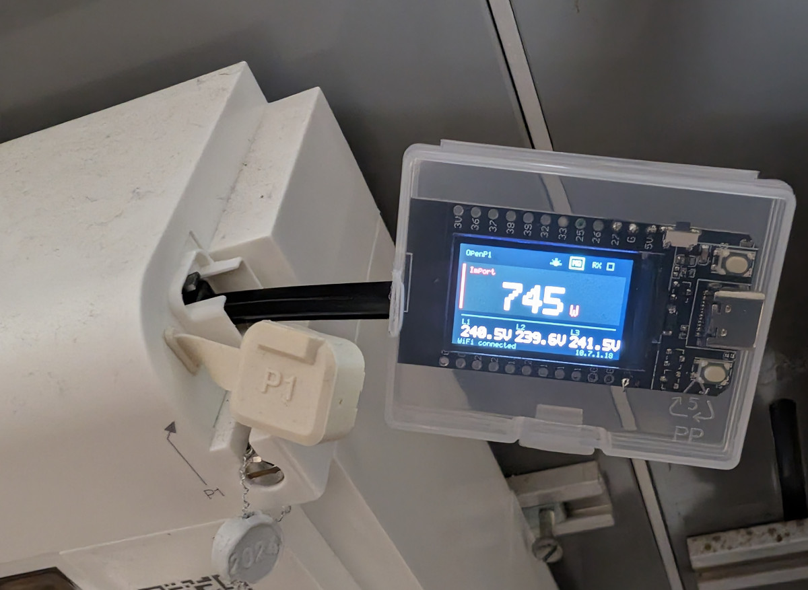

# OpenP1 Display user guide

OpenP1 Display reads compatible electricity-meter P1 data and shows grid import
and export on a local color screen. It also provides a web dashboard, MQTT output,
Home Assistant Discovery, read-only diagnostics and browser firmware updates.



This guide covers the current firmware. Software through M6 is implemented and
accepted by user report; electrical verification and prolonged M7 tests remain
open. A matching connector alone does not establish meter compatibility.

## 1. Prepare the hardware

The board profile targets a Tenstar TS0636G T-Display, classic ESP32, with 16 MiB
flash. Meter UART RX uses GPIO27; GPIO16 is reserved for LCD DC. The proposed
interface requires a compatible signal and a 10 kohm RX pull-up to 3.3 V.

Review [hardware and conditional pinout](../hardware/HARDWARE.md) before wiring. Confirm the
meter interface, connector orientation, actual flash capacity and supply budget.
The project does not establish universal P1 meter support.

**Disconnect the entire meter cable before connecting USB. Never power the
module from USB and the meter at the same time.**

The access button is **S2, the lower-left button next to the USB-C port**, with
the display facing you and the USB-C port on the left. See the
[front photo](../hardware/Front.jpg). Firmware settings/messages call this GPIO35 button **S2**. The other button is not the access button. S2/GPIO35
support defaults off in menuconfig until its external/onboard pull-up is verified.

## 2. Build and install

Install PlatformIO Core or its VS Code extension. From the project directory:

```sh
pio run -e tenstar_tdisplay
```

The project pins espressif32 6.9.0 and ESP-IDF 5.3.1. It uses C++17-compatible
application code, not Arduino. The supplied partition table requires 16 MiB flash.

For the first installation, or an old factory-only partition layout, upload by
USB with the meter completely disconnected:

```sh
pio device list
pio run -e tenstar_tdisplay -t upload --upload-port /dev/ttyUSB0
pio device monitor -b 115200
```

Replace the example port with the actual board port. This installation supplies
the bootloader, OTA partition table, metadata and application. Later compatible
updates can use the web interface. See [build troubleshooting](BUILD_TROUBLESHOOTING.md)
for port discovery, older saved profiles and linker errors.

## 3. Connect to Wi-Fi

1. On an unconfigured device, join the setup AP shown on its LCD.
2. Open the captive portal, or manually open the setup address on the LCD.
3. Select a network or enter its SSID, provide its password and connect.
4. Join the station network and open `http://<device-ip>/` using the IP on the LCD.

Provisioning exposes Wi-Fi setup only. Normal settings and diagnostics are
available after station setup. A network outage triggers reconnection; it does
not erase Wi-Fi credentials or open unrestricted settings.

Use the displayed IP directly for Settings. Host/origin validation can reject
alternate names or proxy access. The pages are served by the device without a CDN.

## 4. Read the screen and dashboard

| Indicator | Meaning |
| --- | --- |
| Large Import/Export power | Net grid power; red import, green export |
| Amber readings | Stale data rather than a new valid sample |
| L1/L2/L3 | Individual phase voltages when available |
| Wi-Fi icon | Connection and signal strength |
| MQ | Green connected, amber waiting, red error, gray disabled |
| RX pulse | A successfully decoded notification, including simulation |
| Footer | IP/setup/access information |

The web dashboard shows net power above Wi-Fi quality, then connection/source and
readings. Net power is import OBIS `1-0:1.7.0` minus export `1-0:2.7.0`. Export is
negative and import positive. Its default gauge range is −5 to +5 kW. The number
can exceed the gauge range even when the marker stops at an endpoint.

If export is absent, the derived display/gauge may assume zero export. Missing
import or a transmitted but invalid/stale export is not replaced with zero.
This display rule does not change actual parser or MQTT readings.

Messages received counts decoded notifications since restart, not UART chunks,
HDLC segments or MQTT subscriptions. Failed frames do not increment it.

## 5. Choose network access

There is no application password. Access policies are intended for a trusted LAN.
A fresh configuration defaults to Full; saved policies persist across restart.

| Policy | Available through the network |
| --- | --- |
| None | No ordinary readings/configuration; LCD, acquisition and MQTT continue |
| View | Dashboard, readings and read-only diagnostics |
| Full | All of the above, Settings and firmware upload |

When button support is enabled, press and release S2 to
grant Full for 300 seconds. Locked browser pages wait for the grant and return to
the dashboard. An eight-second hold resets Wi-Fi only, with a visible countdown.

Saving the access policy restarts the module and ends temporary grants. Verify
that the button works before relying on it to regain Full after selecting a
restricted policy. Access changes are enforced on APIs, streams and uploads.

## 6. Configure Settings

Open Settings while effective access is Full. The Settings link is only shown
when Full is available.

| Section | Use | Application |
| --- | --- | --- |
| Device | Installed firmware version, uptime and memory status | Read-only |
| Network access | Persist None/View/Full | Save and restart |
| Display | Rotate LCD 180°, change symmetric web gauge range | Next refresh |
| Meter UART | Baud, parity, stop bits, inversion | Save and restart |
| Simulation | Source, input layer and replay sequence | Save and restart |
| MQTT | Broker, TLS, credentials, prefix and output switches | Save configuration |
| Firmware update | Validated application binary upload | Upload and restart |

The default UART profile is **115200, 8 data bits, no parity, 1 stop bit, inverted
RX**. Use settings matching the actual meter. Saving UART does not disable
simulation; source selection is separate. Saved runtime settings override initial
menuconfig defaults on later boots.
See [country and meter profiles](countries/README.md) for documented installation
settings, including Switzerland / Romande Energie.

Settings shows save progress, success or failure beside the action. After a
request timeout the save result can be unknown; inspect the device before retrying.
Mutating requests are not automatically repeated.

## 7. Publish to MQTT

In Settings, enable MQTT and enter the broker host, port and credentials. Plain
MQTT defaults to port 1883. Optional TLS checks the broker certificate and hostname;
it needs a valid clock and public trust bundle or supplied private CA. Certificate
verification cannot be disabled.

Blank credential fields preserve saved credentials; explicit clear controls remove
them. Secrets are not fetched back into the browser. Configure a prefix, for example
`/sensors/power/p1meter`. Its initial slash is preserved and is significant in MQTT.
Do not use a trailing slash or wildcard characters.

| Output switch | Published topic suffixes |
| --- | --- |
| JSON state | `state` |
| Text measurements | `id`, `active`, `voltage`, `current`, `metering` |
| Raw/HDLC hex | `raw`, `hdlc` |
| Individual OBIS | e.g. `1-0:51.7.0` |
| Home Assistant Discovery | Entity configuration; keep JSON state enabled |

Real data uses `<prefix>/<topic>`; simulation uses `<prefix>/simulation/<topic>`.
There is no `/normal` or `/text` component. The configured text ID label is not the
meter's serial number or automatic manufacturer detection. Raw/decoded payloads
can still contain actual meter identifiers.

Illustrative payloads, not measurements from a real installation:

```text
/sensors/power/p1meter/id ExampleMeter
/sensors/power/p1meter/active 1200 0 1000.00 100.00
/sensors/power/p1meter/voltage 230.00 230.00 231.00 229.00
/sensors/power/p1meter/current 6.00 1.00 2.00 3.00
/sensors/power/p1meter/metering 400000 600000 30000 70000
/sensors/power/p1meter/1-0:51.7.0 2
```

`active` contains import/export W, then import/export kWh. `voltage` contains
mean then L1/L2/L3 V; `current` contains sum then L1/L2/L3 A. `metering` contains
import tariff 1/2 then export tariff 1/2 in Wh. Incomplete/stale summary groups
are omitted. See [MQTT reference](MQTT.md) for defaults, retention and units.

Settings reports broker status, errors and messages accepted by the local MQTT
client since restart. Acceptance does not prove delivery to a subscriber. The
latest error remains visible after reconnect. No debug payload history is stored.

## 8. Try simulation

Enable Simulation, select the input layer and use the default sequence or enter
complete hex. The built-in sequence uses identifiers `12345678` and `1234567`.
Save and restart to apply. Simulation disables UART and repeats after 3.5 seconds.

Choose wire HDLC for original frames with checksums, or LLC/APDU for reassembled
application bytes. The latter produces no fabricated raw HDLC frame. Limits are
4096 text characters and 2048 decoded bytes. MQTT-style `topic hex` lines are also
accepted. See [input format](CAPTURE_FORMAT.md).

To return to the actual meter, disable simulation and save/restart. Pause, speed,
file import/export and advanced replay controls are not provided.

## 9. Inspect diagnostics

Open Diagnostics from the dashboard or Settings with View/Full access. It shows
raw chunks, decoded scalar/string readings, timestamps, scalers/units and parser
counters/latest error. Unknown OBIS objects remain available when supported.

The raw tail is only four chunks of up to 256 bytes and can start mid-frame;
raw/decoded panels are separate snapshots, not a synchronized full history.
There is no capture download/export or historical error log. Actual meter IDs
can appear: anonymize screenshots, logs and payloads before sharing them.

## 10. Update firmware in the browser

Build a package without flashing:

```sh
python3 scripts/build-firmware.py --version 2026.10.27
```

Open Full Settings → Firmware update and upload
`dist/openp1-display-2026.10.27.bin`. Choose the application binary only; `.sha256`
and `.json` are sidecars. Do not upload a merged image, bootloader or partition
table. Keep power stable until restart and then check version, settings and MQTT.

Updates need the OTA layout installed by USB first. Upload is bounded to 3 MiB
and 180 seconds. Images are validated before boot selection, and NVS settings
are preserved. A new image is confirmed after startup checks; pre-confirmation
resets can roll back. This is not automatic detection of every later functional
fault, and SHA256 is an integrity check rather than publisher authentication.
See [firmware update reference](FIRMWARE_UPDATE.md) for recovery and full details.

## 11. Troubleshoot

| Symptom | What to check |
| --- | --- |
| No readings | Source selection, compatible RX wiring, UART settings and diagnostics |
| Unsupported APDU | Correct input layer and complete supported payload; preserve raw bytes for diagnosis |
| Settings absent or locked | Effective Full access; enabled access button; use station IP |
| Wi-Fi setup page instead of Settings | Complete Wi-Fi provisioning first |
| MQTT connected but a topic is absent | Output switch, exact prefix including leading slash, fresh complete readings |
| Home Assistant entities have no updates | JSON state enabled and broker connection healthy |
| TLS connection fails | Clock/NTP, broker hostname and trust chain |
| Uptime/API temporarily unavailable | Network/server availability and heap status; a failed read is not proof of reboot |
| Web update unavailable | Full access, OTA layout and startup verification state |
| Old version after attempted update | Validation error or rollback; inspect version/log before retrying |
| Repeated Wi-Fi/MQTT memory errors | Free heap/largest block, enabled outputs and logs; follow the stability test plan |

For development use [architecture](ARCHITECTURE.md), [API](API.md),
[requirements](REQUIREMENTS.md) and [build troubleshooting](BUILD_TROUBLESHOOTING.md).
For validation use the [M7 test plan](TEST_PLAN.md). Historical pre-release notes
are not current instructions.
